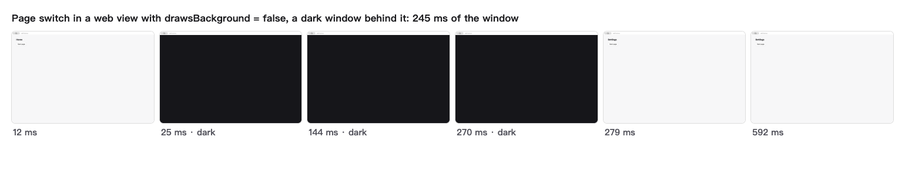
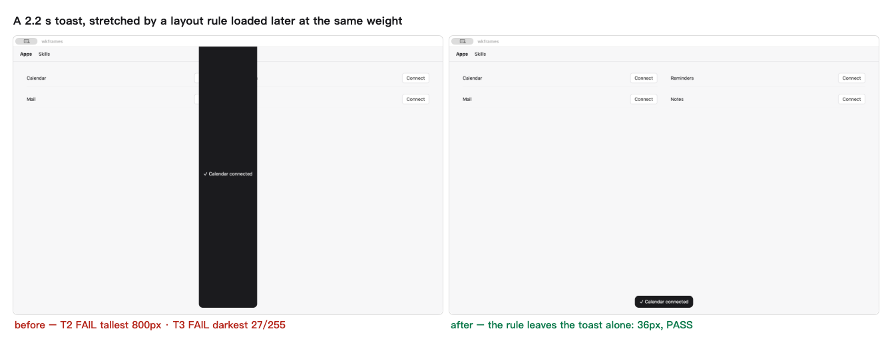

# wkframes

English · [繁體中文](README.zh-TW.md) · [简体中文](README.zh-CN.md)

**Record what a WKWebView really shows, frame by frame, while a script drives the page.**

For Mac apps whose interface is a web page inside a native window. Some bugs only happen there: not in Chrome, not in
Safari, not in Playwright's WebKit. They often last a few frames. wkframes opens your page in the system WKWebView, in a
window set up the way your app sets it up. It runs a scenario script and records what the window server puts on the screen,
every frame. You get PASS or FAIL lines and an exit status.



## When you need it

| You see this | Why other tools miss it | What wkframes does |
|---|---|---|
| A dark or white flash when a page changes, only in the app | The web view draws no background (`drawsBackground = false`). Wherever the page paints nothing, the *window* shows. A browser always has its own white canvas. | `--transparent-webview --window-bg` makes the same window. `probe.rec(…, { points })` gives each point's colour in every frame. |
| Something drawn wrong for a moment: a toast, a dialog closing, an animation | A screenshot only lands at one instant. The DOM may look right while the screen does not. | Records every changed frame (up to 120 fps), with a time for each frame. |
| Broken in the shipped app, fine on the dev server | The built bundle can load styles in a different order. The app's window, title bar and native bridges are not in the browser. | Point it at the built pages. `--transparent-titlebar` matches the window, and `--inject` adds stand-ins for native bridges. |
| "It's fixed": now prove it | Before/after screenshots have to be timed by hand. | The same scenario against the old and the new build. Frames and the result are saved for the bug report. |
| It must not come back | Most UI tests run in a browser, not in your web view. | `probe.check(...)` sets the exit status, so you can run it in a script or locally before a release. |



## How it compares

| | wkframes | Playwright WebKit video | Safari Web Inspector › Screenshots | Appium Mac2 | Screen recorders |
|---|:-:|:-:|:-:|:-:|:-:|
| The system WKWebView your app uses | ✓ | – own WebKit build | ✓ | ✓ | ✓ |
| Your app's window: transparent web view, window colour, title bar | ✓ flags | – | only in your app | only in your app | only in your app |
| Driven by a script | ✓ | ✓ | – by hand | ✓ through accessibility | – |
| Every frame as the screen shows it | ✓ | video | after each composite | video | video |
| Colour of a point over time, as a check | ✓ | – | – | – | – |
| Needs your app built or running | – just the pages | – | `isInspectable` in your app | ✓ | ✓ |

## Install

macOS 14 or later, Xcode command line tools.

```bash
git clone https://github.com/william19307/wkframes && cd wkframes
swift build -c release
cp .build/release/wkframes /usr/local/bin/   # or run it from .build/release
```

On the first recording, macOS asks for **Screen Recording** permission for the app that runs wkframes (Terminal,
iTerm, your editor). Allow it in System Settings › Privacy & Security › Screen Recording, then run again.

## Try the examples

```bash
wkframes examples/toast-column/index.html examples/toast-column/scenario.js
# PASS T1 the toast showed – 97 samples
# FAIL T2 the toast stays a pill (DOM) – tallest 800px
# FAIL T3 nothing dark above it (screen) – darkest 27 of 255 at (640, 120) over 153 frames

wkframes "file://$PWD/examples/toast-column/index.html?fixed" examples/toast-column/scenario.js
# PASS … tallest 36px … darkest 247 of 255

wkframes examples/window-flash/index.html examples/window-flash/scenario.js --transparent-webview --window-bg "#16161a"
# FAIL W2 no flash of the window behind the page – 28 of 89 frames dark, 245 ms (first switch-002.png)

wkframes examples/window-flash/index.html examples/window-flash/scenario.js
# PASS – the same page in a web view that draws its own background: what a browser shows
```

Pictures, `<name>.json` (time and pixels per frame) and `result.json` go to `./wkframes-out` (`--out` to change it).
To watch a recording: `ffmpeg -framerate 60 -i wkframes-out/switch-%03d.png switch.mp4`.

## Usage

```
wkframes <url> <scenario.js> [options]

the window, as your app makes it:
  --size WxH                 web view size in points (default 1280x800)
  --dark                     dark appearance
  --window-bg <css colour>   the window's background colour
  --transparent-titlebar     full-size content view under a transparent title bar
  --transparent-webview      drawsBackground = false
  --inject <file.js>         a user script at document start, before the page's own (repeatable)

the run:
  --out <dir>                where pictures and result.json go (default ./wkframes-out)
  --fps <n>                  most frames per second to record (default 120)
  --capture-scale <s>        scale of recorded pictures, 0.25–1 (default 1)
  --timeout <seconds>        give up after this long (default 120)
  --interactive              let the mouse reach the window
```

Exit status: 0 when every check passed, 1 when one failed or the run broke, 2 for a usage error.

## Writing a scenario

A scenario is the body of an async function. It runs once the page has loaded, with `probe` in scope:

```js
const rec = probe.rec("close", 1200, { points: [[640, 120]] }); // start recording, sample one point
await rec.started;                                              // act only once the first frame is in
probe.click("dialog button.done");
const { frames } = await rec;                                   // [{ file, t, px: [[r, g, b]] }, …]
probe.check("D1", frames.every((f) => probe.lum(f.px[0]) > 150), "nothing dark while it closes");
```

| | |
|---|---|
| `probe.wait(ms)` · `probe.until(fn, ms)` | wait for a time, or until `fn()` is truthy (resolves with its value, or `null`) |
| `probe.$(sel, i)` · `probe.$$(sel)` · `probe.text(sel, re)` | find elements |
| `probe.click(sel \| el)` · `probe.key(key, opts)` | events made in the page; the real mouse and keyboard are never used |
| `await probe.shot(name)` | one picture of the window as shown → its path |
| `probe.rec(name, ms, { points, save })` | every changed frame for `ms`; `.started` resolves once recording runs; `points` are CSS pixels of the page; `save: false` keeps only the pixels |
| `probe.check(id, ok, what, detail)` | a PASS or FAIL line; any FAIL makes the exit status 1 |
| `probe.lum([r, g, b])` · `probe.log(x)` | luminance 0–255; anything to keep in `result.json` |

Whatever the scenario returns goes to `result.json` as `value`.

### Stand-ins for native bridges

Pages in an app often call native code. The page cannot tell a stand-in from the real thing, so `--inject` a script that
answers the same calls with made-up data:

```js
// calendar-shim.js – the page calls window.native.calendar.lists()
window.native = { calendar: { lists: async () => [{ id: "1", name: "Work" }, { id: "2", name: "Home" }] } };
```

```bash
wkframes https://localhost:5173/settings scenario.js --inject calendar-shim.js --transparent-webview --window-bg "#f8f8f8"
```

The same way, an injected script can set a signed-in state in `localStorage` or turn on a feature flag before the page's
own code runs.

## While it runs

- The window floats above the others and **lets clicks pass through**. WebKit slows or stops drawing a covered window,
  so it has to stay visible. A click at the Mac must not change the page under the scenario either.
- It has no Dock icon and never takes the keyboard focus. It closes by itself when the scenario ends, or after
  `--timeout`.
- To stop it at once: `pkill -x wkframes`.

## Limits

- macOS only, 14 or later. The window must be on screen. It is not headless, so on CI it needs a logged-in macOS runner
  with Screen Recording allowed.
- One page load per run. A scenario that navigates away loses its `probe`.
- Input is made of DOM events: no real hover, IME, native drag or context menus.
- ScreenCaptureKit only delivers frames that changed. A still screen gives few frames, and that is expected.
- It reproduces your app's web view, not the whole app. Native views drawn over the page are not there.

## License

Apache License 2.0 – see [LICENSE](LICENSE).
