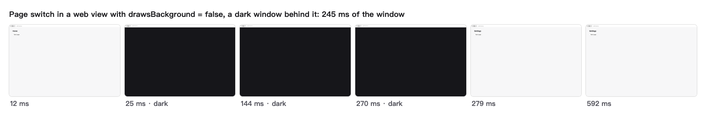
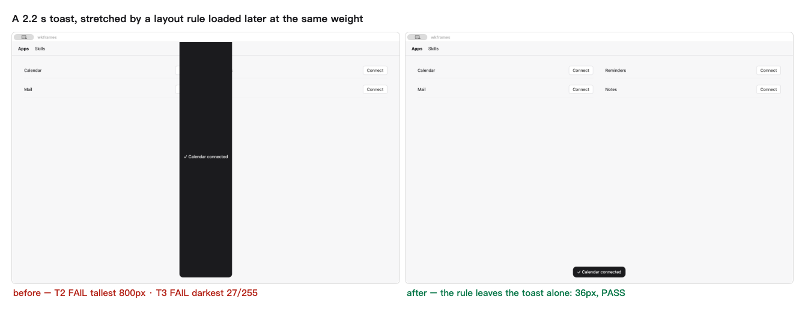

# wkframes

[English](README.md) · [繁體中文](README.zh-TW.md) · 简体中文

**用脚本操作页面，把 WKWebView 真正画在屏幕上的样子逐帧录下来。**

适用于界面是网页、外面包一层原生窗口的 Mac 应用。有些问题只会在这种应用里出现：Chrome 里没有，Safari 里没有，Playwright 的
WebKit 里也没有，而且往往只持续几帧就消失。wkframes 用系统的 WKWebView 打开你的页面，窗口按你应用的方式设置，然后运行场景脚本，
把窗口服务器实际送上屏幕的每一帧录下来。最后给出 PASS／FAIL 结果和退出码。



## 什么时候用得上

| 你看到的 | 其他工具为什么抓不到 | wkframes 怎么做 |
|---|---|---|
| 切换页面时闪黑或闪白，只有应用里会 | WebView 不画背景（`drawsBackground = false`），页面没画到的地方会露出*窗口*。浏览器永远有自己的白底。 | 用 `--transparent-webview --window-bg` 做出同样的窗口；`probe.rec(…, { points })` 给出每一帧里指定点的颜色。 |
| 某个东西短暂画错：提示消息（toast）、对话框关闭、动画 | 截图只能拍到某一瞬间；DOM 看起来没问题，屏幕上却不对。 | 录下每一帧有变化的画面（最高每秒 120 帧），每帧带时间。 |
| 开发服务器上正常，打包成应用就坏 | 打包后样式的加载顺序可能不同；应用的窗口、标题栏、原生桥接，浏览器里都没有。 | 直接打开打包后的页面；`--transparent-titlebar` 对齐窗口，`--inject` 放原生桥接的替身。 |
| 「修好了」，要拿出证据 | 修复前后的截图得自己掐准时间。 | 同一个脚本跑旧版和新版，每帧画面和结果都保存下来，可以附在 bug 报告里。 |
| 不能再坏一次 | 大部分 UI 测试跑在浏览器里，而不是你的 WebView。 | `probe.check(...)` 决定退出码，可以放进脚本，或在发版前本地跑一遍。 |



## 和其他工具对比

| | wkframes | Playwright WebKit 录制 | Safari 网页检查器 › 截图 | Appium Mac2 | 录屏工具 |
|---|:-:|:-:|:-:|:-:|:-:|
| 用你应用所用的系统 WKWebView | ✓ | – 自己编译的 WebKit | ✓ | ✓ | ✓ |
| 你应用的窗口：透明 WebView、窗口底色、标题栏 | ✓ 用参数 | – | 只能在你的应用里 | 只能在你的应用里 | 只能在你的应用里 |
| 用脚本操作 | ✓ | ✓ | – 手动 | ✓ 通过辅助功能 | – |
| 屏幕上显示的每一帧 | ✓ | 视频 | 每次合成之后 | 视频 | 视频 |
| 某一点的颜色随时间变化，用来做检查 | ✓ | – | – | – | – |
| 需要先构建或运行你的应用 | – 只要页面 | – | 应用要开启 `isInspectable` | ✓ | ✓ |

## 安装

需要 macOS 14 及以上和 Xcode 命令行工具。

```bash
git clone https://github.com/william19307/wkframes && cd wkframes
swift build -c release
cp .build/release/wkframes /usr/local/bin/   # 或者直接从 .build/release 运行
```

第一次录制时，macOS 会为运行 wkframes 的应用（终端、iTerm、你的编辑器）申请**录屏**权限。到「系统设置 › 隐私与安全性」里的
「录屏与系统录音」（旧版叫「屏幕录制」）允许它，然后再运行一次。

## 跑一下示例

```bash
wkframes examples/toast-column/index.html examples/toast-column/scenario.js
# PASS T1 the toast showed – 97 samples
# FAIL T2 the toast stays a pill (DOM) – tallest 800px
# FAIL T3 nothing dark above it (screen) – darkest 27 of 255 at (640, 120) over 153 frames

wkframes "file://$PWD/examples/toast-column/index.html?fixed" examples/toast-column/scenario.js
# PASS … tallest 36px … darkest 247 of 255

wkframes examples/window-flash/index.html examples/window-flash/scenario.js --transparent-webview --window-bg "#16161a"
# FAIL W2 no flash of the window behind the page – 28 of 89 frames dark, 245 ms (first switch-002.png)

wkframes examples/window-flash/index.html examples/window-flash/scenario.js
# PASS – 同一个页面放在会自己画背景的 WebView 里，也就是浏览器里看到的样子
```

截图、`<名称>.json`（每帧的时间和像素）和 `result.json` 会放在 `./wkframes-out`（用 `--out` 修改位置）。
想看成视频：`ffmpeg -framerate 60 -i wkframes-out/switch-%03d.png switch.mp4`。

## 用法

```
wkframes <网址> <场景.js> [选项]

窗口，按你应用的做法：
  --size 宽x高               WebView 尺寸，单位 pt（默认 1280x800）
  --dark                     深色外观
  --window-bg <CSS 颜色>     窗口的背景色
  --transparent-titlebar     内容延伸到透明标题栏下面（full-size content view）
  --transparent-webview      drawsBackground = false
  --inject <文件.js>         在文档开始时、页面自己的代码之前注入的脚本（可重复）

本次运行：
  --out <目录>               截图和 result.json 放在哪里（默认 ./wkframes-out）
  --fps <n>                  每秒最多录多少帧（默认 120）
  --capture-scale <倍率>     录下画面的缩放，0.25–1（默认 1）
  --timeout <秒>             超过多久就放弃（默认 120）
  --interactive              让鼠标可以点到窗口
```

退出码：所有检查都通过是 0，有一项没通过或运行出错是 1，参数错误是 2。

## 编写场景脚本

场景脚本是一个 async 函数的函数体。页面加载完成后运行，可以直接使用 `probe`：

```js
const rec = probe.rec("close", 1200, { points: [[640, 120]] }); // 开始录制，采样一个点
await rec.started;                                              // 等第一帧进来再动手
probe.click("dialog button.done");
const { frames } = await rec;                                   // [{ file, t, px: [[r, g, b]] }, …]
probe.check("D1", frames.every((f) => probe.lum(f.px[0]) > 150), "nothing dark while it closes");
```

| | |
|---|---|
| `probe.wait(ms)` · `probe.until(fn, ms)` | 等一段时间，或等到 `fn()` 为真（返回它的值，超时返回 `null`） |
| `probe.$(sel, i)` · `probe.$$(sel)` · `probe.text(sel, re)` | 查找元素 |
| `probe.click(sel \| el)` · `probe.key(key, opts)` | 在页面里触发事件；不会动到真实的鼠标和键盘 |
| `await probe.shot(name)` | 截一张屏幕上显示的窗口 → 返回文件路径 |
| `probe.rec(name, ms, { points, save })` | 录下 `ms` 毫秒内每一帧有变化的画面；`.started` 在录制真正开始后完成；`points` 是页面的 CSS 像素坐标；`save: false` 只保留像素、不存图 |
| `probe.check(id, ok, what, detail)` | 一行 PASS 或 FAIL；只要有一个 FAIL，退出码就是 1 |
| `probe.lum([r, g, b])` · `probe.log(x)` | 亮度 0–255；想保留在 `result.json` 里的任何内容 |

场景脚本返回的值会写进 `result.json` 的 `value`。

### 原生桥接的替身

应用里的页面经常调用原生代码。页面分不出替身和真实实现，所以可以用 `--inject` 注入一段脚本，用假数据响应同样的调用：

```js
// calendar-shim.js – 页面会调用 window.native.calendar.lists()
window.native = { calendar: { lists: async () => [{ id: "1", name: "Work" }, { id: "2", name: "Home" }] } };
```

```bash
wkframes https://localhost:5173/settings scenario.js --inject calendar-shim.js --transparent-webview --window-bg "#f8f8f8"
```

用同样的方法，注入的脚本还可以在页面自己的代码运行前，先在 `localStorage` 里放好登录状态，或者打开某个功能开关。

## 运行时

- 窗口会浮在其他窗口上面，**点击会穿过它**。WebKit 对被遮住的窗口会少画或停画，所以它必须一直可见；另外，在电脑前点一下，也不应该改动脚本正在操作的页面。
- 它没有 Dock 图标，也不会抢走键盘焦点。场景跑完会自动关闭，或在 `--timeout` 之后关闭。
- 想立刻停止：`pkill -x wkframes`。

## 限制

- 只支持 macOS 14 及以上。窗口必须在屏幕上，不能无头运行；放到 CI 上，需要一台已登录、允许录屏的 macOS 机器。
- 每次运行只加载一个页面。场景脚本如果跳转到别的网址，就会失去 `probe`。
- 输入是 DOM 事件：没有真实的鼠标悬停、输入法、原生拖放或右键菜单。
- ScreenCaptureKit 只发送有变化的帧。画面静止时帧数很少，这是正常的。
- 它重现的是你应用的 WebView，而不是整个应用；叠在页面上面的原生界面不会出现。

## 许可证

Apache License 2.0，详见 [LICENSE](LICENSE)。
