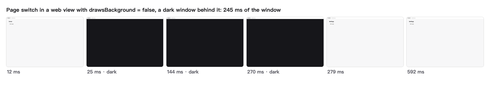
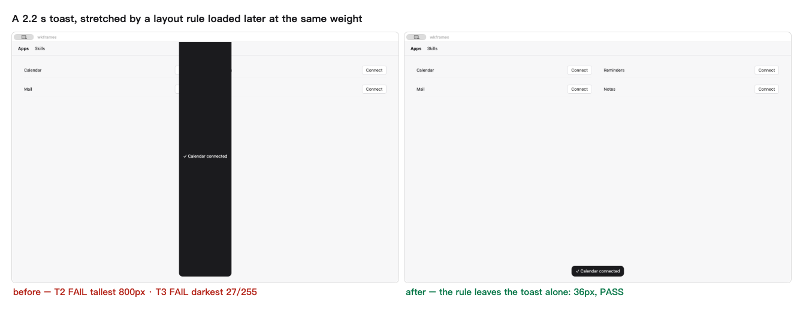

# wkframes

[English](README.md) · 繁體中文 · [简体中文](README.zh-CN.md)

**用腳本操作頁面，把 WKWebView 真正畫在螢幕上的樣子，一格一格錄下來。**

適用介面是網頁、外面包一層原生視窗的 Mac app。有些錯誤只會在這種 app 裡出現：Chrome 沒有、Safari 沒有、Playwright 的 WebKit
也沒有，而且常常只持續幾格就消失。wkframes 用系統的 WKWebView 打開你的頁面，視窗照你 app 的方式設定，接著執行情境腳本，
把視窗伺服器實際送上螢幕的每一格錄下來。最後給你 PASS／FAIL 結果和結束代碼。



## 什麼時候用得到

| 你看到的 | 其他工具為什麼抓不到 | wkframes 怎麼做 |
|---|---|---|
| 換頁時閃黑或閃白，只有 app 裡會 | 網頁視圖不畫背景（`drawsBackground = false`），頁面沒畫到的地方會露出*視窗*。瀏覽器永遠有自己的白底。 | 用 `--transparent-webview --window-bg` 做出同樣的視窗；`probe.rec(…, { points })` 給你每一格裡指定點的顏色。 |
| 某個東西短暫畫錯：提示訊息（toast）、對話框關閉、動畫 | 截圖只拍到某一瞬間；DOM 看起來對，螢幕上卻不對。 | 錄下每一格有變化的畫面（最高每秒 120 格），每格附時間。 |
| 開發伺服器上正常，打包成 app 就壞 | 打包後樣式的載入順序可能不同；app 的視窗、標題列、原生橋接，瀏覽器裡都沒有。 | 直接開打包後的頁面；`--transparent-titlebar` 對齊視窗，`--inject` 放原生橋接的替身。 |
| 「修好了」，要拿出證據 | 修正前後的截圖得自己抓準時間。 | 同一個腳本跑舊版和新版，每格畫面和結果都存下來，可以附在問題回報裡。 |
| 不能再壞一次 | 大部分 UI 測試跑在瀏覽器，不是你的網頁視圖。 | `probe.check(...)` 決定結束代碼，可以放進腳本，或發版前在本機跑一次。 |



## 和其他工具比較

| | wkframes | Playwright WebKit 錄影 | Safari 網頁檢閱器 › 截圖 | Appium Mac2 | 螢幕錄影工具 |
|---|:-:|:-:|:-:|:-:|:-:|
| 用你 app 所用的系統 WKWebView | ✓ | – 自己編譯的 WebKit | ✓ | ✓ | ✓ |
| 你 app 的視窗：透明網頁視圖、視窗底色、標題列 | ✓ 用參數 | – | 只能在你的 app 裡 | 只能在你的 app 裡 | 只能在你的 app 裡 |
| 用腳本操作 | ✓ | ✓ | – 手動 | ✓ 透過輔助使用 | – |
| 螢幕上顯示的每一格 | ✓ | 影片 | 每次合成之後 | 影片 | 影片 |
| 某一點的顏色隨時間變化，拿來當檢查 | ✓ | – | – | – | – |
| 需要先建置或執行你的 app | – 只要頁面 | – | app 要開 `isInspectable` | ✓ | ✓ |

## 安裝

需要 macOS 14 以上和 Xcode 命令列工具。

```bash
git clone https://github.com/william19307/wkframes && cd wkframes
swift build -c release
cp .build/release/wkframes /usr/local/bin/   # 或直接從 .build/release 執行
```

第一次錄影時，macOS 會替執行 wkframes 的 app（終端機、iTerm、你的編輯器）要求**螢幕錄製**權限。到「系統設定 › 隱私權與安全性」裡的
「螢幕與系統錄音」（舊版叫「螢幕錄製」）允許它，再執行一次。

## 試跑範例

```bash
wkframes examples/toast-column/index.html examples/toast-column/scenario.js
# PASS T1 the toast showed – 97 samples
# FAIL T2 the toast stays a pill (DOM) – tallest 800px
# FAIL T3 nothing dark above it (screen) – darkest 27 of 255 at (640, 120) over 153 frames

wkframes "file://$PWD/examples/toast-column/index.html?fixed" examples/toast-column/scenario.js
# PASS … tallest 36px … darkest 247 of 255

wkframes examples/window-flash/index.html examples/window-flash/scenario.js --transparent-webview --window-bg "#16161a"
# FAIL W2 no flash of the window behind the page – 28 of 89 frames dark, 245 ms (first switch-002.png)

wkframes examples/window-flash/index.html examples/window-flash/scenario.js
# PASS – 同一頁放在會自己畫背景的網頁視圖裡，也就是瀏覽器看到的樣子
```

畫面、`<名稱>.json`（每格的時間和像素）和 `result.json` 會放在 `./wkframes-out`（用 `--out` 改位置）。
想看成影片：`ffmpeg -framerate 60 -i wkframes-out/switch-%03d.png switch.mp4`。

## 用法

```
wkframes <網址> <情境.js> [選項]

視窗，照你 app 的做法：
  --size 寬x高               網頁視圖大小，單位 pt（預設 1280x800）
  --dark                     深色外觀
  --window-bg <CSS 顏色>     視窗的背景色
  --transparent-titlebar     內容延伸到透明標題列底下（full-size content view）
  --transparent-webview      drawsBackground = false
  --inject <檔案.js>         在文件開始時、頁面自己的程式之前注入的腳本（可重複）

這次執行：
  --out <資料夾>             畫面和 result.json 放哪（預設 ./wkframes-out）
  --fps <n>                  每秒最多錄幾格（預設 120）
  --capture-scale <倍率>     錄下畫面的縮放，0.25–1（預設 1）
  --timeout <秒>             超過多久就放棄（預設 120）
  --interactive              讓滑鼠可以點到視窗
```

結束代碼：每個檢查都通過是 0，有一個沒過或執行出錯是 1，參數錯誤是 2。

## 寫情境腳本

情境腳本是一個 async 函式的內容。頁面載入完成後執行，可以直接用 `probe`：

```js
const rec = probe.rec("close", 1200, { points: [[640, 120]] }); // 開始錄影，取樣一個點
await rec.started;                                              // 等第一格進來再動手
probe.click("dialog button.done");
const { frames } = await rec;                                   // [{ file, t, px: [[r, g, b]] }, …]
probe.check("D1", frames.every((f) => probe.lum(f.px[0]) > 150), "nothing dark while it closes");
```

| | |
|---|---|
| `probe.wait(ms)` · `probe.until(fn, ms)` | 等一段時間，或等到 `fn()` 為真（回傳它的值，逾時回傳 `null`） |
| `probe.$(sel, i)` · `probe.$$(sel)` · `probe.text(sel, re)` | 找元素 |
| `probe.click(sel \| el)` · `probe.key(key, opts)` | 在頁面裡產生事件；不會動到真的滑鼠和鍵盤 |
| `await probe.shot(name)` | 拍一張螢幕上顯示的視窗 → 回傳檔案路徑 |
| `probe.rec(name, ms, { points, save })` | 錄下 `ms` 毫秒內每一格有變化的畫面；`.started` 在錄影真的開始後完成；`points` 是頁面的 CSS 像素座標；`save: false` 只留像素、不存圖 |
| `probe.check(id, ok, what, detail)` | 一行 PASS 或 FAIL；只要有一個 FAIL，結束代碼就是 1 |
| `probe.lum([r, g, b])` · `probe.log(x)` | 亮度 0–255；想留在 `result.json` 的任何東西 |

情境腳本回傳的值，會寫進 `result.json` 的 `value`。

### 原生橋接的替身

app 裡的頁面常常會呼叫原生程式。頁面分不出替身和真的，所以可以用 `--inject` 注入一段腳本，用假資料回應同樣的呼叫：

```js
// calendar-shim.js – 頁面會呼叫 window.native.calendar.lists()
window.native = { calendar: { lists: async () => [{ id: "1", name: "Work" }, { id: "2", name: "Home" }] } };
```

```bash
wkframes https://localhost:5173/settings scenario.js --inject calendar-shim.js --transparent-webview --window-bg "#f8f8f8"
```

用同樣的方式，注入的腳本也能在頁面自己的程式執行前，先在 `localStorage` 放好登入狀態，或打開某個功能開關。

## 執行的時候

- 視窗會浮在其他視窗上面，**點擊會穿過它**。WebKit 對被蓋住的視窗會少畫或停畫，所以它必須一直看得到；另外，在 Mac 前面點一下，也不該改到腳本正在操作的頁面。
- 它沒有 Dock 圖示，也不會搶走鍵盤焦點。情境跑完會自己關掉，或在 `--timeout` 之後關掉。
- 想馬上停掉：`pkill -x wkframes`。

## 限制

- 只支援 macOS 14 以上。視窗必須在螢幕上，不能無頭執行；放在 CI 上，需要一台已登入、允許螢幕錄製的 macOS 機器。
- 一次執行只載入一頁。情境腳本如果換到別的網址，就會失去 `probe`。
- 輸入是 DOM 事件：沒有真的滑鼠懸停、輸入法、原生拖放或右鍵選單。
- ScreenCaptureKit 只送出有變化的畫面。畫面靜止時格數很少，這是正常的。
- 它重現的是你 app 的網頁視圖，不是整個 app；疊在頁面上面的原生畫面不會出現。

## 授權

Apache License 2.0，見 [LICENSE](LICENSE)。
